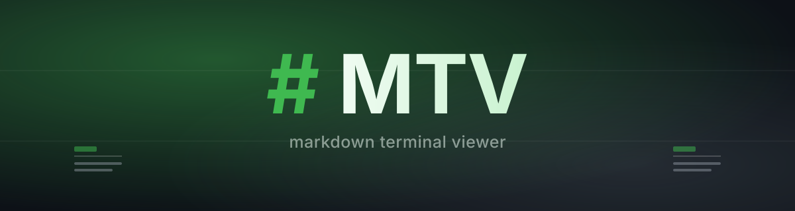
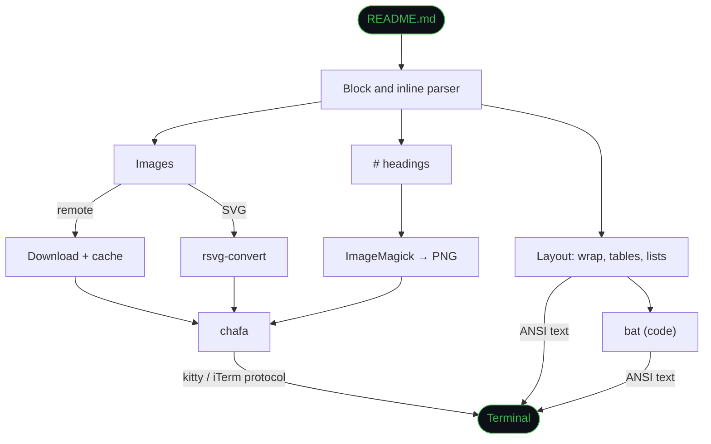

<p align="center">
  
</p>

<p align="center">
  
  
  
  
  
</p>

MTV (Markdown Terminal Viewer) shows a Markdown file in the terminal the way GitHub shows a README: real images, big headings, tables, highlighted code, and the HTML that READMEs are actually written with — centered banners, rows of badges, screenshots side by side, collapsible sections.

One Python file, nothing to `pip install`. Images are drawn with [chafa](https://hpjansson.org/chafa/), through the terminal's graphics protocol.

## Index

- [Why](#why)
- [Installation](#installation)
- [Usage](#usage)
- [What it renders](#what-it-renders)
- [Terminals](#terminals)
- [How it fits together](#how-it-fits-together)
- [Under the hood](#under-the-hood)
- [Troubleshooting](#troubleshooting)
- [Known limitations](#known-limitations)
- [License](#license)

## Why

Terminal Markdown viewers are good at prose and bad at READMEs. A real README opens with `<p align="center"></p>`, a row of shields.io badges and a screenshot — and that's exactly the part most viewers print as raw HTML or skip. What's left is a wall of same-sized text that looks nothing like the page on GitHub.

MTV is built around that first screen:

- **Images are images**: local or remote, PNG, JPEG, GIF, WebP or SVG, at the width the README asks for.
- **Headings are big**: `#` and `##` are drawn in a proportional bold font, larger than the body text, with GitHub's rule underneath.
- **README HTML works**: `<p align="center">`, `` four in a row, `<details>`, `<br>`, `<b>`, `<kbd>`, `<a>`.
- **The rest is there too**: tables, fenced code with syntax highlighting, task lists, nested lists, quotes, `[!NOTE]`-style alerts and clickable links.

<details>
<summary><b>Text rendition of the output</b></summary>
<br>

```text
                 ┌──────────────────────────────────────────────────────┐
                 │                    (banner image)                    │
                 └──────────────────────────────────────────────────────┘
                     [platform macOS] [swift 5.9] [license MIT]

  A Stream Deck for your Mac that lives on your phone. A menu bar app on the
  Mac serves a panel over your local network; you scan a QR code…

  Installation                          ← drawn large, in a proportional font
  ────────────────────────────────────────────────────────────────────────────

  ▄▄▄▄▄▄▄▄▄▄▄▄▄▄▄▄▄▄▄▄▄▄▄▄▄▄▄▄▄▄▄▄▄▄▄▄▄▄▄▄▄▄▄▄▄▄▄▄▄▄▄▄▄▄▄▄▄▄▄▄▄▄▄▄▄▄▄▄▄▄▄▄▄▄▄▄
    git clone https://github.com/alexcalatyd/iDeck.git
    ./build.sh --install
  ▀▀▀▀▀▀▀▀▀▀▀▀▀▀▀▀▀▀▀▀▀▀▀▀▀▀▀▀▀▀▀▀▀▀▀▀▀▀▀▀▀▀▀▀▀▀▀▀▀▀▀▀▀▀▀▀▀▀▀▀▀▀▀▀▀▀▀▀▀▀▀▀▀▀▀▀

  ▎ 💡 Tip
  ▎ build.sh signs with your Apple Development certificate if there's one in
  ▎ the keychain.

  ┌──────────┬───────────────────────────────────────────────────────────────┐
  │ Screen   │ What's in it                                                  │
  ├──────────┼───────────────────────────────────────────────────────────────┤
  │ Controls │ Brightness and volume as tall Control Center pills, and round │
  │          │ buttons for everything else.                                  │
  └──────────┴───────────────────────────────────────────────────────────────┘
```

Where this says *(banner image)* and shows bracketed badges, the real thing draws the actual pictures; the heading is an image too, so plain text can't show its size.

</details>

## Installation

| Tool | What for | Required |
|---|---|:-:|
| `python3` (3.8+) | the program itself | ✅ |
| `chafa` | drawing images | optional |
| `imagemagick` | the big headings | optional |
| `librsvg` | crisp SVG (banners, badges) | optional |
| `bat` | syntax highlighting in code blocks | optional |

```sh
brew install chafa imagemagick librsvg bat
```

Every optional tool that's missing just switches its feature off: without `chafa` images become a one-line `▣ alt text`, without `imagemagick` headings are bold text, without `bat` code is uncolored.

> [!NOTE]
> MTV is developed and tested on **macOS** with **Ghostty**. It's plain Python and the tools above exist on Linux too, but it hasn't been tested there, nor in the other terminals listed under [Terminals](#terminals).

To clone it and have it available from anywhere:

```sh
git clone https://github.com/alexcalatyd/MTV.git
cd MTV
ln -s "$PWD/mtv" /opt/homebrew/bin/mtv
```

Any directory on your `PATH` works in place of `/opt/homebrew/bin` (`~/.local/bin`, `/usr/local/bin`…). There is no build step and nothing else to install; to update, `git pull`.

## Usage

```sh
mtv                   # the README.md in the current folder
mtv docs/guide.md     # a specific file
mtv ~/code/project    # a folder: opens its README.md
cat notes.md | mtv -  # from stdin
```

The output is printed straight into the terminal, like `cat`, so you read it with your normal scrollback.

| Option | What it does |
|---|---|
| `-w`, `--width N` | maximum text width in columns (100 by default) |
| `-t`, `--tty` | draw on the terminal even if stdout is redirected (see [Troubleshooting](#troubleshooting)) |
| `-V`, `--version` | print the version |
| `-h`, `--help` | help |

| Variable | What it does |
|---|---|
| `MTV_WIDTH` | same as `--width` |
| `MTV_GRAPHICS` | force the graphics protocol: `kitty`, `iterm`, `sixels` or `none` |
| `MTV_FG`, `MTV_BG` | `#rrggbb` text and background colors, for terminals that don't answer the color query |

When stdout is a pipe or a file, MTV prints clean text with no escape codes, so `mtv file.md | less` and `mtv file.md > out.txt` do what you'd expect.

## What it renders

| Markdown | In the terminal |
|---|---|
| `#`, `##` | large proportional bold text (an image), with a rule underneath |
| `###` and deeper | bold text |
| Images, `` | the picture, honoring `width` in `%` or px and `align="center"` |
| Several images in one paragraph | placed side by side, wrapping when they don't fit |
| Fenced code | a tinted block, highlighted by `bat` when the language is known |
| Tables | box-drawing borders, column alignment, cells that wrap |
| Lists | bullets by depth, numbers, `[ ]` / `[x]` task boxes |
| Quotes and alerts | a colored bar; `[!NOTE]`, `[!TIP]`, `[!IMPORTANT]`, `[!WARNING]`, `[!CAUTION]` |
| Links | underlined and clickable (OSC 8), without printing the URL |
| `<details>` | shown expanded, with its summary as a title |
| `**bold**`, `*italic*`, `~~strike~~`, `` `code` `` | the terminal's own styles |

Remote images are downloaded once and cached for a day in `~/.cache/mtv`, along with the rendered headings and SVGs.

## Terminals

| Terminal | Images and big headings |
|---|:-:|
| Ghostty | ✅ tested |
| kitty, WezTerm | kitty graphics protocol — should work, untested |
| iTerm2 | iTerm inline images — should work, untested |
| Anything else (Terminal.app, inside tmux…) | chafa's character art for images, bold text for headings |

The protocol is picked from `TERM_PROGRAM` and `TERM`. If your terminal supports one and isn't detected, set `MTV_GRAPHICS`.

## How it fits together



## Under the hood

<details>
<summary><b>How the headings get big</b></summary>
<br>

A terminal has one font size. To draw a heading larger than the body, MTV renders the text to a transparent PNG with ImageMagick — bold, sized relative to the terminal's cell height, in the terminal's own foreground color — and shows it as an image two rows tall. The foreground and background colors come from asking the terminal (OSC 10 and 11), which is also how code blocks get a tint that matches any theme. If the terminal doesn't answer, headings fall back to bold text rather than risk white on white.

</details>

<details>
<summary><b>How images are sized and placed</b></summary>
<br>

GitHub's content column is about 880 px wide, so an image's width is mapped proportionally onto MTV's text column: a 440 px image takes half of it, `width="85%"` takes 85 %, and nothing grows past the full width or the height of the window. The cell size in pixels comes from the terminal (`TIOCGWINSZ`), which is what turns "half the column" into an exact number of columns and rows.

To put images side by side, MTV first prints as many blank lines as the tallest one needs, moves back up, and for each image saves the cursor, moves right, lets `chafa` draw, and restores the cursor. Reserving the space first means the screen never scrolls halfway through a row.

SVGs are rasterized by `rsvg-convert` at the exact pixel width they'll occupy, so badges and banners stay sharp instead of being scaled up from their nominal size.

</details>

<details>
<summary><b>Why a hand-written parser</b></summary>
<br>

The interesting part of a README isn't Markdown, it's the HTML in between, and a terminal renderer needs to know things a generic Markdown library doesn't keep: that a paragraph is *only* images, which `align` is in effect, what `width` an `` asked for. Writing the parser by hand keeps all of that in one pass and keeps the promise of a single file with no dependencies. The cost is in [Known limitations](#known-limitations).

</details>

## Troubleshooting

<details>
<summary><b>Images show as <code>▣ alt text</code> and headings aren't big</b></summary>
<br>

MTV decided it isn't writing to a terminal, so it printed the plain-text version. The usual cause is a shell setup that pipes every command's output through something (a `tee` that records the last output, a logging wrapper). Use `--tty` to draw on the terminal regardless:

```sh
mtv --tty README.md
```

Or make it permanent in your `~/.zshrc`:

```sh
alias mtv='mtv --tty'
```

If stdout really is the terminal, check that `chafa` is installed and that the terminal is one of those under [Terminals](#terminals); otherwise set `MTV_GRAPHICS=kitty` (or `iterm`).

</details>

<details>
<summary><b>Images work but headings are plain bold text</b></summary>
<br>

Either `imagemagick` is missing (`brew install imagemagick`) or the terminal didn't answer the color query. In the second case, tell MTV the colors yourself:

```sh
export MTV_FG='#e6e6e6' MTV_BG='#1c1c1e'
```

</details>

<details>
<summary><b>SVG banners or badges look blurry</b></summary>
<br>

Install `librsvg` (`brew install librsvg`). Without it the SVG goes to chafa at its nominal size and gets scaled up.

</details>

<details>
<summary><b>A remote image doesn't show</b></summary>
<br>

Downloads time out after 6 seconds and a failed image is replaced by its alt text. Run it again once the network is back; successful downloads are cached for a day.

</details>

## Known limitations

- **No pager.** The whole document is printed at once and you scroll back through it. Images don't survive `less`.
- **Mermaid diagrams aren't drawn.** They're shown as a code block labeled as such.
- **Not a full CommonMark implementation.** The parser covers what READMEs use; unusual nesting, footnotes, HTML tables and reference-style images are simplified or ignored.
- **`<details>` is always open.** There is nothing to click in a printed document.
- **Opening a README fetches its remote images**, exactly as a browser would. When the output is piped, or with `MTV_GRAPHICS=none`, nothing is requested.
- Tested on macOS with Ghostty only.

## License

MIT — see [LICENSE](LICENSE).

<p align="center"><sub># Read the README where you already are.</sub></p>
